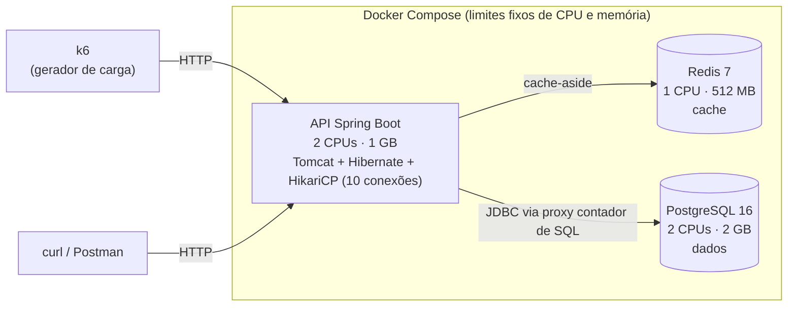
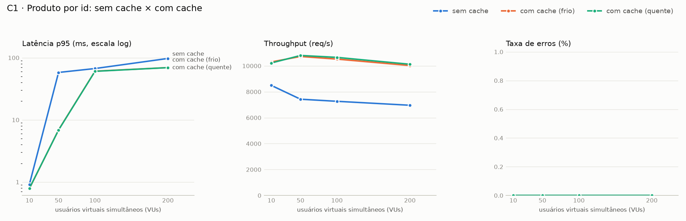
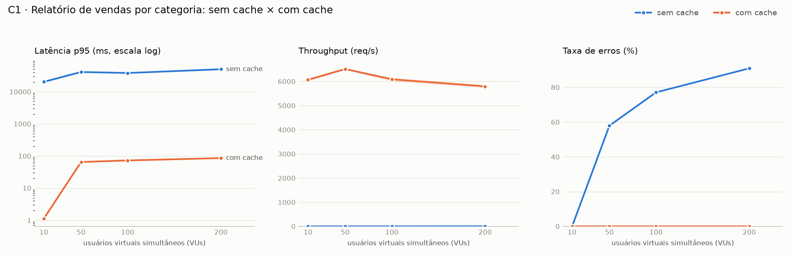
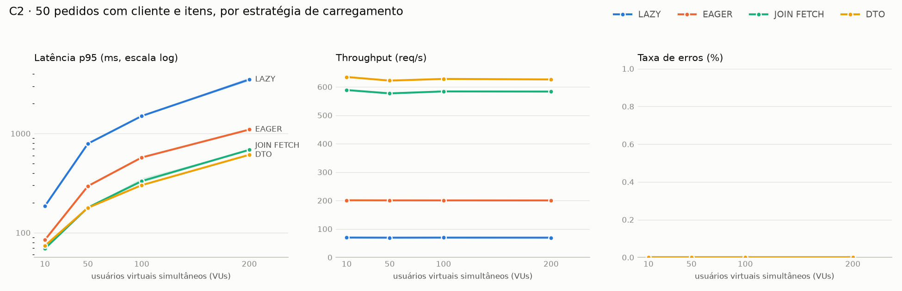
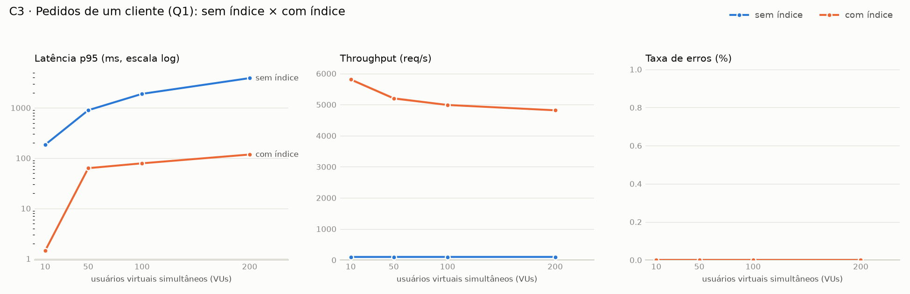

# Otimização de Web Services: cache, consultas ao banco e testes de desempenho

Relatório técnico do trabalho prático da disciplina **Análise e Otimização de Sistemas**
(Ciência da Computação). Trabalho individual.

Todos os números deste relatório foram **medidos** no ambiente descrito na seção 2.5.
Cada tabela indica de onde vem. Os arquivos brutos estão em [`docs/evidencias/`](docs/evidencias/).

**Sumário**

1. [Introdução](#1-introdução)
2. [Arquitetura e tecnologias](#2-arquitetura-e-tecnologias)
3. [Implementação de cache](#3-implementação-de-cache)
4. [Otimização das consultas](#4-otimização-das-consultas)
5. [Testes de desempenho](#5-testes-de-desempenho)
6. [Discussão](#6-discussão)
7. [Conclusão](#7-conclusão)
- [Apêndice A: como executar e reproduzir](#apêndice-a-como-executar-e-reproduzir)
- [Apêndice B: mapa das evidências](#apêndice-b-mapa-das-evidências)

---

## 1. Introdução

A aplicação é uma **API REST de um sistema de pedidos** (categorias, produtos, clientes,
pedidos e itens), sem interface gráfica. Ela foi construída para servir de laboratório: cada
operação existe em mais de uma versão (com e sem cache, LAZY, EAGER e variantes otimizadas, com
e sem índice), e todas as versões de uma mesma operação devolvem **o mesmo JSON**. Assim, a
única diferença entre elas é a estratégia de acesso aos dados.

Objetivos, um para cada item do enunciado:

| Item | Pergunta | Como foi respondida |
|---|---|---|
| 1. Cache | Quanto o cache reduz o acesso ao banco e o tempo de resposta? Quando ele não ajuda? | Redis com cache-aside, TTL e invalidação; experimento 3.4; medições por requisição e sob carga |
| 2. Consultas | Como LAZY e EAGER se comportam de fato? Quanto ganham JOIN FETCH, DTO, batch e SQL nativo? Quanto ganha um índice? | SQL contado por requisição; `n` = 10, 100 e 1000; `EXPLAIN ANALYZE` antes e depois dos índices |
| 3. Desempenho | Os ganhos se mantêm sob 10, 50, 100 e 200 usuários simultâneos? Onde estão os gargalos? | k6 com 132 execuções (11 variantes × 4 cargas × 3 repetições), com CPU e memória dos containers |

A aplicação expõe em toda resposta cabeçalhos de instrumentação (`X-SQL-Count`, `X-SQL-Ms`,
`X-Elapsed-Ms` e, nos endpoints com cache, `X-Cache`). Com isso, cada requisição feita com curl,
Postman ou k6 já é uma evidência: dá para ver quantos comandos SQL ela gerou, quanto tempo
passou no banco e se o cache foi usado.

---

## 2. Arquitetura e tecnologias

### 2.1 Visão geral



A API é organizada em camadas convencionais (`web` → `service` → `repository` → `domain`), no
pacote `br.edu.aos.pedidos`. Um filtro HTTP (`MetricasRequisicaoFilter`) e um proxy de
`DataSource` (`datasource-proxy`) medem cada requisição e cada comando SQL.

### 2.2 Tecnologias e justificativas

| Tecnologia | Versão | Por quê |
|---|---|---|
| Java + Spring Boot | 21 / 3.5.16 | Recomendação do enunciado; Spring Data JPA, abstração de cache e Actuator prontos |
| JPA / Hibernate | 6.6 | Oferece LAZY/EAGER, `JOIN FETCH`, `@EntityGraph`, `@BatchSize` e projeções, todos necessários para o Item 2 |
| PostgreSQL | 16 | **Não cria índice automaticamente em chave estrangeira** (o MySQL/InnoDB cria). Assim, o cenário "sem índice" é real. O `EXPLAIN (ANALYZE, BUFFERS)` é bem detalhado |
| Flyway | 11.7 | Schema versionado. O Hibernate só valida (`ddl-auto: validate`) e nunca cria tabelas ou índices por conta própria |
| Redis | 7.4 | Cache em processo separado: dá para observar `TTL`, `MONITOR` e as chaves ao vivo. Ele também tem custo de rede e serialização, o que alimenta a pergunta "o cache sempre ajuda?" |
| datasource-proxy | 1.11.1 | Conta os comandos SQL de cada requisição e mede o tempo no banco (`X-SQL-Count`, `X-SQL-Ms`) |
| Grafana k6 | 2.4.0 | Scripts em JavaScript, p95/p99 nativos, cenários por número de VUs e exportação em JSON |
| Docker Compose | 5.8 | Postgres, Redis e a API com limites fixos de CPU e memória, o mesmo ambiente em todas as execuções |
| Python + matplotlib | 3.12 / 3.11 | Agrega as repetições e gera as tabelas e os gráficos da seção 5 |

### 2.3 Modelo de dados e volume

```
Categoria (50) 1──N Produto (20.000)
                         │ 1
                         N
Cliente (10.000) 1──N Pedido (200.000) 1──N ItemPedido (1.099.698)
```

| Tabela | Colunas | Linhas |
|---|---|---:|
| `categoria` | id, nome, descricao | 50 |
| `produto` | id, nome, preco, estoque, categoria_id (FK), atualizado_em | 20.000 |
| `cliente` | id, nome, email, cidade, uf, criado_em | 10.000 |
| `pedido` | id, cliente_id (FK), data_pedido, status, valor_total | 200.000 |
| `item_pedido` | id, pedido_id (FK), produto_id (FK), quantidade, preco_unitario | 1.099.698 |

- O schema base ([`db/migration/V1__schema.sql`](db/migration/V1__schema.sql)) tem **apenas as
  chaves primárias e estrangeiras**. Os índices de experimento ficam à parte, em
  [`db/indices/`](db/indices/), para que o cenário "sem índice" seja real.
- Os dados são gerados por SQL com `generate_series` ([`db/seed/seed.sql`](db/seed/seed.sql)),
  com `setseed`, portanto de forma reprodutível. As distribuições são propositalmente **não uniformes**:
  - pedidos por cliente com cauda longa (o cliente 1 tem 1.971 pedidos; o cliente 5000, usado
    como "típico" nos planos de execução, tem 13; a média é 20);
  - status: 70% ENTREGUE, 10% ENVIADO, 8% PAGO, 7% PENDENTE, 5% CANCELADO;
  - datas espalhadas em 3 anos;
  - produtos de id baixo vendem mais.

### 2.4 Endpoints

| Grupo | Endpoint | O que faz |
|---|---|---|
| Cache (Item 1) | `GET /api/produtos/{id}/sem-cache` · `/com-cache` | Produto + categoria por id |
| | `PUT /api/produtos/{id}` | Altera preço e estoque e **invalida** a entrada do cache |
| | `GET /api/relatorios/vendas-por-categoria/sem-cache` · `/com-cache` | Faturamento por categoria (agrega ~1,1 milhão de itens) |
| | `PUT /api/pedidos/{id}/status` | Muda o status (cancelar um pedido altera o faturamento) |
| | `DELETE /api/admin/cache` | Esvazia o cache (controle do estado inicial dos testes) |
| Consultas (Item 2) | `GET /api/pedidos/{estrategia}?n=` | Os `n` pedidos mais recentes com cliente, itens e produto. `estrategia` ∈ `lazy`, `eager`, `join-fetch`, `entity-graph`, `batch`, `dto`, `nativo`, `join-fetch-paginacao-memoria` |
| Índices (Item 2) | `GET /api/clientes/{id}/pedidos` | Pedidos de um cliente, do mais recente ao mais antigo (consulta Q1) |

Cabeçalhos em **toda** resposta, inclusive nas de erro:

| Cabeçalho | Significado |
|---|---|
| `X-SQL-Count` | Comandos SQL executados durante a requisição |
| `X-SQL-Ms` | Tempo somado desses comandos no banco (ms, medido com `nanoTime`) |
| `X-Elapsed-Ms` | Tempo total da requisição dentro da API (ms) |
| `X-Cache` | `HIT`, `MISS` ou `BYPASS` (só nos endpoints de cache) |

### 2.5 Ambiente de medição

| Item | Configuração |
|---|---|
| Máquina | Linux Zorin OS 18.1 (base Ubuntu 24.04), kernel 7.0.0-43, 12 CPUs, 15 GiB de RAM, Docker nativo |
| API | Container com **2 CPUs e 1 GB** (`-XX:MaxRAMPercentage=75`), pool do Hikari com 10 conexões |
| PostgreSQL | Container com 2 CPUs e 2 GB, `shared_buffers=512MB`, `max_connections=200`, `/dev/shm` de 1 GB |
| Redis | Container com 1 CPU e 512 MB, sem persistência, `maxmemory 256mb` (`allkeys-lru`) |
| k6 | No próprio host, fora dos containers |

As tabelas e os índices (≈ 150 MB no total) cabem nos 512 MB de `shared_buffers`. Os planos de
execução mostram leituras só da memória (`shared hit`). Ou seja, os experimentos medem CPU, não
disco. Esse ponto volta na discussão (seção 6.5).

---

## 3. Implementação de cache

### 3.1 O que foi colocado em cache e por quê

Foram escolhidas duas operações de perfis opostos, para responder se o cache sempre ajuda:

| Operação | Frequência de acesso | Volatilidade | Custo no banco | Risco de dado desatualizado | TTL | Invalidação |
|---|---|---|---|---|---|---|
| Produto por id (`produtos::{id}`) | Alta (vitrine, carrinho) | Média: preço e estoque mudam | **Baixo**: busca por PK (~0,4 ms no banco) | Alto: preço errado no carrinho | 10 min | Explícita: o `PUT /api/produtos/{id}` remove a chave |
| Relatório de vendas por categoria (`relatorio-vendas::todas`) | Média (painel gerencial) | Muda a cada pedido, mas ninguém precisa do valor ao segundo | **Alto**: agrega ~1,1 milhão de itens (~1 s) | Baixo: é um indicador, e alguns segundos de atraso são aceitáveis | 60 s | Só por expiração (TTL) |

- **Produto:** dado consultado com muita frequência, mas mutável. O TTL de 10 min é só uma
  rede de segurança. A correção vem da invalidação na escrita.
- **Relatório:** muito caro e tolerante a atraso. Invalidá-lo a cada pedido o deixaria quase
  sempre vazio, então ele expira pelo TTL e o atraso máximo é conhecido: 60 s.

### 3.2 Tecnologia: Redis

O Redis é um armazenamento chave-valor em memória, num processo separado da API. Foi escolhido
em vez de um cache local (Caffeine) por três motivos:

1. É compartilhado entre instâncias da API.
2. Sobrevive a reinícios da aplicação.
3. Permite inspecionar o cache ao vivo (`TTL`, `EXISTS`, `MONITOR`), o que serve de evidência
   para o experimento 3.4.

O preço dessa escolha é uma ida pela rede e a serialização em cada acesso. Esse custo aparece
nos resultados (seção 3.5).

### 3.3 Implementação: cache-aside

O cache é usado de forma programática, e não com `@Cacheable`, para que a resposta saiba se
houve HIT ou MISS e possa expor isso em `X-Cache`. O fluxo é o mesmo do `@Cacheable`. Trecho de
[`ProdutoService`](app/src/main/java/br/edu/aos/pedidos/service/ProdutoService.java):

```java
public ResultadoCache<ProdutoDTO> buscarComCache(Long id) {
    ProdutoDTO emCache = cache.get(id, ProdutoDTO.class);
    if (emCache != null) {
        return ResultadoCache.hit(emCache);          // HIT: nenhuma conexão do pool é usada
    }
    ProdutoDTO doBanco = carregar(id);               // MISS: 1 SQL (produto JOIN FETCH categoria)
    cache.put(id, doBanco);
    return ResultadoCache.miss(doBanco);
}

@Transactional
public ProdutoDTO atualizar(Long id, AtualizacaoProdutoDTO dados) {
    Produto produto = produtos.buscarComCategoria(id).orElseThrow(() -> naoEncontrado(id));
    produto.atualizar(dados.preco(), dados.estoque());
    cache.evict(id);                                  // executado só DEPOIS do commit
    return ProdutoDTO.de(produto);
}
```

Configuração em [`CacheConfig`](app/src/main/java/br/edu/aos/pedidos/config/CacheConfig.java):

- Um TTL para cada cache, configurável em `app.cache.*`. O profile `demo` encurta os dois
  para 20 s, para a demonstração.
- Valores gravados em **JSON legível**, inspecionável com `redis-cli GET`.
- `RedisCacheManager` **transaction-aware**: o `evict` feito dentro da transação do `PUT` só
  acontece depois do commit. Sem isso, outra requisição poderia ler o valor antigo do banco
  entre o evict e o commit e repovoar o cache com ele.

### 3.4 TTL e invalidação: experimento obrigatório

Executado por [`analise/experimento_cache.sh`](analise/experimento_cache.sh), com a API no
profile `demo` (TTL de 20 s). Saída completa em
[`docs/evidencias/cache/experimento-3.4.md`](docs/evidencias/cache/experimento-3.4.md) e log do
Redis em [`redis-monitor.txt`](docs/evidencias/cache/redis-monitor.txt). O script restaura os
dados ao final.

**A. Produto 42: reaproveitamento, invalidação e expiração**

| Passo | Requisição | X-Cache | X-SQL-Count | X-Elapsed-Ms | Preço retornado |
|---|---|---|---:|---:|---:|
| A1 consulta | `GET /api/produtos/42/com-cache` | MISS | 1 | 5,03 | 244,88 |
| A2 repete | `GET /api/produtos/42/com-cache` | **HIT** | **0** | 2,47 | 244,88 |
| A3 altera | `PUT /api/produtos/42` (preço 299,90) | | 2 | 5,66 | 299,90 |
| A4 consulta | `GET /api/produtos/42/com-cache` | **MISS** | 1 | 4,77 | **299,90** (atualizado) |
| A5 repete | `GET /api/produtos/42/com-cache` | HIT | 0 | 2,04 | 299,90 |
| A6 após 21 s | `GET /api/produtos/42/com-cache` | **MISS** (expirou) | 1 | 4,49 | 299,90 |

- Logo após o PUT, `EXISTS produtos::42` = 0: a chave foi removida.
- O TTL lido no Redis desceu de 20 s para 15 s após 5 s, e após 21 s a chave já não existia
  (`TTL` = -2).
- Trecho do `MONITOR`: GET sem resposta → SET com `PX 20000` → GET (HIT) → DEL (PUT) → GET → SET
  com o valor novo.

```
"GET" "produtos::42"
"SET" "produtos::42" "{\"id\":42,...,\"preco\":244.88,...}" "PX" "20000"
"GET" "produtos::42"
"DEL" "produtos::42"
"GET" "produtos::42"
"SET" "produtos::42" "{\"id\":42,...,\"preco\":299.90,...}" "PX" "20000"
```

**B. Relatório: dado desatualizado até o TTL vencer (comportamento intencional)**

| Passo | Requisição | X-Cache | X-SQL-Count | X-Elapsed-Ms | Faturamento total |
|---|---|---|---:|---:|---:|
| B1 consulta | `GET .../com-cache` | MISS | 1 | 1.037,40 | 1.578.644.739,33 |
| B2 cancela o pedido 200000 | `PUT /api/pedidos/200000/status` | | 1 | 3,09 | |
| B3 com cache | `GET .../com-cache` | HIT | 0 | 3,30 | 1.578.644.739,33 (**desatualizado**) |
| B4 sem cache | `GET .../sem-cache` | BYPASS | 1 | 979,51 | 1.578.639.271,81 (atual) |
| B5 após expirar | `GET .../com-cache` | MISS | 1 | 989,83 | 1.578.639.271,81 (atual) |

O relatório com cache continuou mostrando o pedido cancelado até a entrada expirar. Esse é o
comportamento escolhido: o atraso máximo é o TTL. O risco é alguém decidir com base num número
até 60 s desatualizado. Para um painel de vendas isso é aceitável; para saldo ou estoque, não.

### 3.5 Resultados comparativos

**Custo por requisição, sem concorrência** ([`docs/evidencias/cache/resumo.md`](docs/evidencias/cache/resumo.md);
um cliente por vez; 200 requisições por variante, 20 nas variantes lentas do relatório)

| Operação | Situação | SQL/req | Tempo na API, mediana (ms) | Tempo no banco, média (ms) |
|---|---|---:|---:|---:|
| Produto | sem cache | 1 | 2,58 | 0,43 |
| Produto | MISS | 1 | 2,82 | 0,36 |
| Produto | **HIT** | **0** | **1,32** | 0 |
| Relatório | sem cache | 1 | 1.005,41 | 1.005,67 |
| Relatório | MISS | 1 | 999,94 | 1.007,46 |
| Relatório | **HIT** | **0** | **1,23** | 0 |

- **Cache miss:** custa o mesmo que não ter cache, mais a gravação no Redis (+0,24 ms no
  produto).
- **Cache hit:** zera o acesso ao banco. No relatório, a mediana cai de ~1 s para 1,23 ms, ou
  seja, **~800× mais rápido**. No produto, cai de 2,58 para 1,32 ms (~2×): ganho relativo
  razoável, mas de só 1,3 ms em termos absolutos.

**Sob carga** (k6, rodada `completa2`; média de 3 repetições; detalhes na seção 5)

| Operação | VUs | Sem cache: req/s · p95 · erros | Com cache: req/s · p95 · erros | CPU do Postgres (sem → com) |
|---|---:|---|---|---|
| Produto (cache frio) | 10 | 8.492,6 · 0,9 ms · 0% | 10.303,1 · 0,8 ms · 0% | 112% → 1% |
| Produto (cache frio) | 200 | 6.960,4 · 97,5 ms · 0% | 10.029,3 · 69,5 ms · 0% | 91% → 1% |
| Relatório | 10 | 0,8 · 20.333 ms · 0% | 6.068,2 · 1,1 ms · 0% | 200% → 41% |
| Relatório | 200 | 6,4 · 50.140 ms · **90,9%** | 5.795,4 · 85,8 ms · 0% | 199% → 9% |

### 3.6 Respostas às questões do item 3.5

**Em quais situações o cache apresentou maior benefício?**
- **Na consulta cara, sob concorrência.** Sem cache, o relatório satura o Postgres: só ~0,8
  relatório por segundo é concluído, qualquer que seja a carga. A partir de 50 VUs, as
  requisições esgotam o pool de conexões e 58% a 91% falham. Com cache, são ~6.000 req/s sem
  nenhum erro.
- **No produto, o ganho cresce com a carga:** +21% de throughput a 10 VUs e +44% a 200 VUs.
  Sem cache, o throughput cai conforme os VUs aumentam; com cache, quase não cai.
- **O cache também tira o banco de cena:** a CPU do Postgres vai de ~100% para 1%, liberando-o
  para outras operações.

**Como a volatilidade dos dados influenciou a escolha do TTL?**
- **Produto:** dado volátil e com alto custo de erro, por isso a correção não depende do TTL e
  sim da invalidação explícita no `PUT`. O TTL de 10 min só limita o tempo de vida de uma
  entrada caso alguma escrita escape da aplicação, por exemplo um `UPDATE` direto no banco.
- **Relatório:** muda a cada pedido. Invalidá-lo a cada escrita faria o cache quase nunca
  acertar, então o TTL (60 s) passa a ser o contrato de atualização: o relatório mostra os
  dados de, no máximo, 60 s atrás.
- **Regra geral:** quanto mais volátil o dado e mais caro o erro, menor o TTL ou mais necessária
  a invalidação explícita.

**Quais são os riscos de utilizar informações desatualizadas?**
- **Decisões tomadas sobre números antigos:** o passo B3 mostrou faturamento com um pedido já
  cancelado.
- **Escritas fora da aplicação:** um `UPDATE` direto no banco não passa pelo `evict`, e o
  produto fica errado até o TTL vencer.
- **Corrida entre leitura e escrita:** mitigada aqui pelo cache *transaction-aware*.
- **Cache stampede:** quando a entrada do relatório expira, várias requisições simultâneas dão
  MISS ao mesmo tempo e repetem a consulta pesada. Isso foi visto na rodada curta de validação.

**O cache sempre melhorou o desempenho?**
Melhorou em todos os cenários medidos, mas com intensidade muito diferente, e com uma ressalva:
- **No MISS, o cache é ligeiramente pior que não ter cache** (2,82 contra 2,58 ms no produto),
  porque a requisição paga a consulta e mais a gravação no Redis.
- **No produto sob carga, o ganho foi modesto:** a busca por PK já é barata, e o gargalo passa
  a ser a CPU da própria API (HTTP e JSON), que o cache não alivia.
- **O cache só compensa claramente quando a consulta evitada custa muito mais que a ida ao
  Redis**, como no relatório.

---

## 4. Otimização das consultas

### 4.1 LAZY × EAGER

Como o `FetchType` é fixo no mapeamento, foram criadas **famílias de entidades somente leitura**
(`@Immutable`) sobre as mesmas tabelas, em [`domain/consulta/`](app/src/main/java/br/edu/aos/pedidos/domain/consulta/):

```java
@Entity @Immutable @Table(name = "pedido")
public class PedidoLazy {
    @ManyToOne(fetch = FetchType.LAZY)  @JoinColumn(name = "cliente_id") private Cliente cliente;
    @OneToMany(fetch = FetchType.LAZY)  @JoinColumn(name = "pedido_id")  private List<ItemPedidoLazy> itens;
}
// PedidoEager: as mesmas associações com FetchType.EAGER
// (e ItemPedidoEager com @ManyToOne(fetch = EAGER) para produto)
```

Todas as estratégias atendem a mesma requisição: **os `n` pedidos mais recentes, com cliente,
itens e produto de cada item**. O JSON de todas é idêntico byte a byte (hash conferido para
n = 1, 100 e 1000). Isso garante que a comparação mede só a forma de buscar os dados.

**O SQL que o Hibernate gerou de fato** (log do profile `sql`, `n = 2`; arquivos completos em
[`docs/evidencias/consultas/sql-gerado/`](docs/evidencias/consultas/sql-gerado/)):

| Estratégia | SQL para n = 2 | Padrão observado |
|---|---:|---|
| LAZY | 13 | 1 consulta dos pedidos, depois 1 `select ... from item_pedido where pedido_id=?` **por pedido**, 1 `select ... from cliente where id=?` por cliente e 1 `select ... from produto where id=?` **por produto distinto** |
| EAGER | 5 | 1 consulta dos pedidos, depois, **para cada pedido**, 1 select do cliente e 1 select dos itens (já com `left join produto`) |
| Batch (`@BatchSize`) | 4 | 1 consulta dos pedidos + 1 por associação, com `where pedido_id = any (?)` |
| JOIN FETCH / DTO | 1 | Um único `select` com os JOINs |

Isso confirma o alerta do enunciado: **EAGER não significa uma única consulta**. Com JPQL
(`select p from PedidoEager p`), o Hibernate executa a consulta e depois carrega as
associações EAGER com *selects* secundários. O resultado é um N+1 "antecipado": acontece mesmo
que ninguém use os dados.

**Comparação com diferentes quantidades de registros** (mediana de 3 execuções; tempo medido na
API; [`docs/evidencias/consultas/resumo.md`](docs/evidencias/consultas/resumo.md))

| Estratégia | SQL (n=10 / 100 / 1000) | n = 1000 sem índice | n = 1000 com índice | JSON (n = 1000) |
|---|---|---:|---:|---:|
| LAZY | 76 / 707 / **6.533** | 49.646 ms | 1.078 ms | 713 KB |
| EAGER | 21 / 201 / **1.906** | 51.182 ms | 390 ms | 713 KB |
| JOIN FETCH | 1 / 1 / 1 | 151 ms | 69 ms | 713 KB |
| EntityGraph | 1 / 1 / 1 | 161 ms | 75 ms | 713 KB |
| Batch (lote de 100) | 4 / 9 / 72 | 585 ms | 70 ms | 713 KB |
| DTO (projeção JPQL) | 1 / 1 / 1 | 134 ms | 47 ms | 713 KB |
| SQL nativo (JdbcTemplate) | 1 / 1 / 1 | 113 ms | **27 ms** | 713 KB |
| JOIN FETCH + `Limit` (armadilha) | 1 / 1 / 1 | 6.175 ms | 6.831 ms | 713 KB |

Observações:

- **N+1 confirmado nas duas estratégias ingênuas.**
  - LAZY: 1 + N (itens) + clientes distintos + produtos distintos. Para n = 10: 1 + 10 + 10 + 55 = 76.
  - EAGER: 1 + N (itens com produto) + clientes distintos. O contexto de persistência evita
    buscar duas vezes o mesmo cliente, por isso n = 1000 dá 1.906 e não 2.001.
- **Sem índice em `item_pedido.pedido_id`, cada SELECT de itens é um Seq Scan de 1,1 milhão de
  linhas** (~28 ms; seção 4.3). Multiplicado por N, isso leva LAZY e EAGER a ~50 s para
  n = 1000. O índice reduz esses mesmos 6.533 comandos a ~1 s: o N+1 continua, mas cada consulta
  fica barata.
- **Dados desnecessários.**
  - EAGER sempre traz cliente, itens e produto, mesmo numa tela que mostrasse só o cabeçalho do
    pedido, com todas as colunas (`email`, `criado_em`, `estoque`, `atualizado_em`), que o JSON
    nem usa.
  - O DTO traz só as 13 colunas da resposta.
  - A armadilha `JOIN FETCH` + `Limit` é o caso extremo: o Hibernate avisa (HHH90003004) e gera
    o SQL **sem LIMIT**. O banco devolve todos os pedidos com todos os itens, e o corte é feito
    em memória. O resultado é ~6 s para qualquer n, até para n = 10.

**Quando usar cada uma?**
- **LAZY** é o padrão adequado para quase tudo: só busca o que for acessado. Isso é ótimo quando
  a tela usa uma fração das associações, ou quando se carrega uma única entidade. O risco é o
  N+1 ao percorrer coleções, que deve ser resolvido **na consulta** (JOIN FETCH, EntityGraph,
  DTO), e não no mapeamento.
- **EAGER** só faz sentido em associações pequenas, *to-one* e **sempre** usadas (por exemplo,
  um item que nunca é exibido sem o produto). Como ele vale para todas as consultas da
  entidade, inclusive as que não precisam da associação, tende a carregar dados desnecessários
  e não elimina o N+1.

### 4.2 Versões otimizadas

```java
// JOIN FETCH: 1 SQL. A subconsulta aplica o LIMIT aos pedidos, não às linhas do JOIN.
@Query("""
        select p from PedidoLazy p
          join fetch p.cliente
          left join fetch p.itens i
          left join fetch i.produto
        where p.id in (select p2.id from PedidoLazy p2 order by p2.id desc limit :n)
        order by p.id desc""")
List<PedidoLazy> recentesJoinFetch(@Param("n") int n);

// DTO: só as colunas da resposta, sem entidades gerenciadas (uma linha por item)
@Query("""
        select new br.edu.aos.pedidos.service.LinhaPedido(
                 p.id, p.dataPedido, p.status, p.valorTotal, c.id, c.nome, c.cidade, c.uf,
                 i.id, i.quantidade, i.precoUnitario, pr.id, pr.nome)
        from PedidoLazy p join p.cliente c join p.itens i join i.produto pr
        where p.id in (select p2.id from PedidoLazy p2 order by p2.id desc limit :n)
        order by p.id desc, i.id""")
List<LinhaPedido> recentesDto(@Param("n") int n);
```

- **JOIN FETCH e EntityGraph** produzem o mesmo SQL. O EntityGraph é a forma declarativa. Os dois
  reduzem tudo a 1 consulta. Para n = 1000, o JOIN FETCH é 16× mais rápido que LAZY e 5,6× mais
  rápido que EAGER com índice, e ~330× mais rápido que os dois sem índice.
  - O custo é o **produto cartesiano**: cada linha do resultado repete os dados do pedido e do
    cliente para cada item.
  - Com duas coleções no mesmo fetch, o Hibernate recusaria a consulta (`MultipleBagFetchException`).
- **Batch fetching** (`@BatchSize(size = 100)`) mantém o código LAZY e troca N consultas por
  ⌈N/100⌉ consultas com `IN`/`ANY`. É a solução menos invasiva: n = 1000 com índice levou 70 ms,
  empatado com o JOIN FETCH.
- **DTO** evita criar entidades gerenciadas, *proxies* e *snapshots* para verificação de
  alterações (*dirty checking*). Foi a versão JPA mais rápida (47 ms em n = 1000 com índice) e,
  sob carga, a que usou menos CPU da API (seção 5).
- **SQL nativo** (JdbcTemplate): mesma consulta, sem Hibernate.

**O SQL nativo trouxe benefício real?** Só nos volumes grandes:

| n | DTO (JPQL), com índice | SQL nativo, com índice |
|---:|---:|---:|
| 10 | 5,14 ms | 4,06 ms |
| 100 | 7,14 ms | 7,87 ms |
| 1000 | 46,95 ms | 26,90 ms |

Em n = 10 e n = 100, a diferença fica dentro da variação entre repetições. Só em n = 1000 a
versão nativa ganha ~20 ms, por não passar pela camada de tradução e materialização do
Hibernate. As consequências:

- **Manutenção:** a SQL é uma string. O `ddl-auto: validate` confere as entidades na
  inicialização, mas não confere essa string; um campo renomeado só quebra em tempo de execução.
  O mapeamento é feito à mão, coluna a coluna (`rs.getLong(1)`, ...).
- **Portabilidade:** a consulta usa `LIMIT`, que não é SQL padrão (o padrão é
  `FETCH FIRST n ROWS`). A JPQL é traduzida para o dialeto de cada banco.
- **Conclusão:** a projeção DTO em JPQL entrega quase todo o ganho (1 SQL, sem entidades)
  mantendo verificação de tipos e portabilidade. O SQL nativo fica reservado para gargalos
  medidos ou recursos específicos do banco.

### 4.3 Índices

Três consultas foram escolhidas ([`db/explain/`](db/explain/)), e para cada uma foi criado um índice
([`db/indices/criar.sql`](db/indices/criar.sql)):

| Consulta | O que exercita | Índice |
|---|---|---|
| Q1: `SELECT * FROM pedido WHERE cliente_id = ? ORDER BY data_pedido DESC` | Filtro + ordenação | `idx_pedido_cliente_data (cliente_id, data_pedido DESC)` |
| Q2: `... WHERE status = ? AND data_pedido BETWEEN ? AND ? ORDER BY data_pedido` | Igualdade + intervalo + ordenação; seletividade | `idx_pedido_status_data (status, data_pedido)` |
| Q3a: itens de um pedido · Q3b: JOIN dos 100 pedidos recentes com cliente, itens e produto | Chave estrangeira sem índice em JOIN | `idx_item_pedido_pedido (pedido_id)` |

**Tempos de execução** (`EXPLAIN (ANALYZE, BUFFERS)`, mediana de 5 execuções após 1 de
aquecimento, gerado por [`db/explain/executar.sh`](db/explain/executar.sh); planos completos em
[`docs/evidencias/explain/`](docs/evidencias/explain/))

| Caso | Linhas | Sem índice: plano | Sem índice | Com índice: plano | Com índice | Redução |
|---|---:|---|---:|---|---:|---:|
| Q1 cliente típico (id 5000) | 13 | Parallel Seq Scan + Sort | 10,36 ms | Bitmap Index Scan + Sort | 0,23 ms | 45× |
| Q1 cliente 1 (o maior) | 1.971 | Seq Scan + Sort | 9,91 ms | Bitmap Index Scan + Sort | 2,59 ms | 3,8× |
| Q2 seletivo (PENDENTE, 1 mês) | 225 | Parallel Seq Scan + Sort | 11,32 ms | Bitmap Index Scan + Sort | 0,55 ms | 21× |
| Q2 amplo (ENTREGUE, 2 anos) | 93.099 | Seq Scan + Sort **em disco** | 60,81 ms | **Index Scan, sem Sort** | 37,98 ms | 1,6× |
| Q3a itens do pedido 199990 | 8 | Parallel Seq Scan (1,1 mi de linhas) | 28,45 ms | Index Scan | 0,13 ms | 216× |
| Q3b JOIN de 100 pedidos | 516 | Hash Join sobre Seq Scan de `item_pedido` | 138,13 ms | Nested Loop com Index Scan | 4,89 ms | 28× |

Trechos dos planos de Q1 (cliente típico):

```
-- sem índice: lê a tabela inteira para achar 13 linhas
Gather Merge (actual time=7.470..10.054 rows=13)
  ->  Sort  (Sort Key: data_pedido DESC, Sort Method: quicksort  Memory: 25kB)
        ->  Parallel Seq Scan on pedido (rows=6 loops=2)
              Filter: (cliente_id = 5000)
              Rows Removed by Filter: 99994
Execution Time: 10.148 ms

-- com índice: vai direto às 13 linhas
Sort  (Sort Key: data_pedido DESC, Sort Method: quicksort  Memory: 25kB)
  ->  Bitmap Heap Scan on pedido (rows=13)   Heap Blocks: exact=13
        ->  Bitmap Index Scan on idx_pedido_cliente_data (rows=13)
              Index Cond: (cliente_id = 5000)
Execution Time: 0.231 ms
```

E de Q2 amplo, em que o índice substituiu uma ordenação em disco:

```
-- sem índice
Sort  (Sort Method: external merge  Disk: 3808kB)
  ->  Seq Scan on pedido (rows=93099)  Rows Removed by Filter: 106901  Buffers: shared hit=1744
Execution Time: 60.412 ms
-- com índice
Index Scan using idx_pedido_status_data on pedido (rows=93099)  Buffers: shared hit=93429
Execution Time: 38.691 ms
```

**Custo dos índices** ([`docs/evidencias/indices/`](docs/evidencias/indices/); escritas desfeitas com `ROLLBACK`)

| Medida | Sem os índices | Com os índices |
|---|---:|---:|
| Tamanho dos novos índices | | `idx_item_pedido_pedido` 12 MB; `idx_pedido_cliente_data` 6,0 MB; `idx_pedido_status_data` 7,5 MB |
| Criação dos três índices | | 0,12 s + 0,22 s + 0,30 s |
| `INSERT` de 50.000 pedidos | 1.160 ms | 1.250 ms (+8%) |
| `INSERT` de 250.000 itens | 10.072 ms | 10.200 ms (+1%) |
| `UPDATE` de `status` em 20.000 pedidos | 79 ms | **194 ms (+145%)** |

**Respostas às questões do item 5.4**

- **O índice foi usado pelo banco?** Sim, nas seis consultas, mas nem sempre do jeito previsto.
  - **Q1:** esperava-se um Index Scan já ordenado (o índice está em `data_pedido DESC`), mas o
    planner preferiu Bitmap Index Scan seguido de Sort. Para 13 linhas, ordenar em memória custa
    quase nada, e o bitmap lê cada página da tabela uma única vez.
  - **Q2 amplo:** esperava-se que o planner **ignorasse** o índice, já que o filtro retorna 47%
    da tabela. Ele o usou, porque a ordem do índice `(status, data_pedido)` atende ao
    `ORDER BY data_pedido` e elimina uma ordenação que, sem índice, ia para o disco (3,8 MB). O
    preço aparece nos buffers: 93.429 páginas lidas contra 1.744 do Seq Scan.
  - **Chaves primárias:** mesmo sem os índices de experimento, o banco já usava os índices das
    PKs. No plano de Q3b sem índice aparecem `Index Scan Backward using pedido_pkey` (os 100
    pedidos mais recentes, `ORDER BY id DESC LIMIT 100`), `cliente_pkey` e `produto_pkey`. A
    única varredura completa é a de `item_pedido`, cuja chave estrangeira não tinha índice.
- **Houve redução no tempo?** Sim, de 1,6× (Q2 amplo) a 216× (Q3a). O maior impacto foi na
  chave estrangeira `item_pedido.pedido_id`. Sem índice, cada busca de itens varre 1,1 milhão
  de linhas, e isso é o que tornava LAZY e EAGER inviáveis (~50 s para n = 1000).
- **Quais fatores influenciaram?**
  - A **seletividade**: 13 linhas dão 45×, 93 mil linhas dão 1,6×.
  - A **distribuição dos dados**: o cliente 1, com 1.971 pedidos, ganhou só 3,8×.
  - A **ordem das colunas** do índice em relação ao `ORDER BY`.
  - A existência de **ordenação em disco**.
  - O **paralelismo** do Seq Scan.
  - O fato de os dados estarem **em memória**: todos os planos mostram `shared hit`, então o
    ganho medido é de CPU. Com dados vindos do disco, a diferença tende a ser maior.
- **Quais os custos de manter índices?**
  - **Espaço:** +25,5 MB para três índices, ou 30% do tamanho das duas tabelas.
  - **Escritas mais lentas:** o `INSERT` fica pouco mais lento. O `UPDATE` de `status` ficou
    2,5× mais lento, porque a coluna passou a ser indexada e o Postgres deixa de fazer
    *HOT update*: cada atualização precisa gravar também uma nova entrada no índice.
  - **Manutenção:** mais trabalho para o `VACUUM`. O inchaço (*bloat*) dos índices foi observado
    e corrigido com `REINDEX` durante os experimentos.
- **Criar índices em todas as colunas consultadas seria uma boa estratégia?** Não.
  - Cada índice cobra em toda escrita e em espaço, como mostrou o `UPDATE` 2,5× mais lento.
  - Colunas pouco seletivas raramente compensam.
  - O planner usa no máximo alguns índices por consulta, e um índice composto bem ordenado vale
    mais que vários índices de uma coluna.
  - O caminho é indexar **as consultas frequentes e caras**, identificadas com `EXPLAIN ANALYZE`.
    As chaves estrangeiras usadas em JOINs são quase sempre candidatas.

---

## 5. Testes de desempenho

### 5.1 Ferramenta

**Grafana k6** (2.4.0). Os testes são scripts em JavaScript versionados no repositório
([`k6/carga.js`](k6/carga.js)), o k6 calcula p95 e p99 nativamente, permite fases (aquecimento
e coleta) com o mesmo número de usuários virtuais e exporta um resumo em JSON por execução
(`handleSummary`). O script também lê os cabeçalhos da API e registra % de HIT, SQL por
requisição e tempo na API.

### 5.2 Cenários

| Cenário | Variante | Requisição |
|---|---|---|
| **C1, cache** | produto sem cache | `GET /api/produtos/{aleatório 1–20000}/sem-cache` |
| | produto com cache **frio** | `.../com-cache`, ids em 1–20000, cache vazio no início |
| | produto com cache **quente** | `.../com-cache`, ids em 1–100, pré-carregados antes do teste |
| | relatório sem / com cache | `GET /api/relatorios/vendas-por-categoria/{sem,com}-cache` |
| **C2, persistência** | LAZY, EAGER, JOIN FETCH, DTO | `GET /api/pedidos/{estrategia}?n=50` (com índices) |
| **C3, índice** | sem índice / com índice | `GET /api/clientes/{aleatório 1–10000}/pedidos` (Q1) |

Cada usuário virtual (VU) faz requisições em sequência, sem pausa (*closed model*). Portanto,
**VUs simultâneos não são requisições por segundo**: o throughput é medido.

### 5.3 Protocolo de execução

O runner [`k6/rodar.sh`](k6/rodar.sh) executou **11 variantes × 4 cargas (10, 50, 100 e 200 VUs) ×
3 repetições = 132 execuções**. A rodada `completa2` foi de 22/11/2026, 02:42 a 07:35. Antes de
cada execução, ele:

1. ajusta os índices (só a variante C3 "sem índice" roda sem eles);
2. **reinicia o container da API** (JVM limpa);
3. **pré-aquece a JVM** por 30 s a 10 VUs com a mesma variante (descartado);
4. esvazia o cache (e, na variante "quente", pré-carrega os 100 produtos);
5. roda o k6: **30 s de aquecimento na carga-alvo (descartado) + 60 s de coleta**;
6. amostra `docker stats` (CPU e memória da API, do Postgres e do Redis) durante o teste.

Cada repetição percorre todas as variantes e cargas antes da próxima começar. Assim, qualquer
variação ao longo do tempo (temperatura, tarefas do sistema) se espalha entre as variantes, em
vez de afetar uma só.

Cuidados do item 6.5:
- **Mesmo ambiente:** limites fixos no Compose.
- **Mesmas cargas** para todas as variantes.
- **Volume de dados registrado** em `rodada.txt`: 200.000 pedidos, 1.099.698 itens, 20.000
  produtos e 10.000 clientes.
- **Estado inicial do cache controlado.**
- **Aquecimento antes da coleta.**
- **Máquina dedicada** durante a rodada.
- **3 repetições.** O intervalo mín–máx do throughput ficou, na maioria das combinações, a cerca
  de 1–2% da média.

> **Por que há pré-aquecimento a 10 VUs.** Uma primeira rodada completa (`completa`, sem o
> passo 3) mostrou o throughput das variantes rápidas caindo à metade a 100 e 200 VUs. A
> investigação ([`diagnostico.md`](docs/evidencias/carga-rodada1/diagnostico.md)) mostrou que a
> queda era um artefato: logo após o reinício, com 100–200 threads de requisição disputando os
> 2 CPUs do container, o compilador JIT da JVM fica sem CPU e 30 s de aquecimento não bastam.
> O produto sem cache a 100 VUs fez 3.306 req/s na 1ª execução após o reinício e ~7.250 nas
> seguintes. Com 30 s a 10 VUs antes, a 1ª execução já chega a ~7.250. A rodada foi refeita com
> esse passo, e os números deste relatório são da segunda rodada. As variantes limitadas pelo
> Postgres deram o mesmo resultado nas duas (LAZY a 10 VUs: 69,5 e 69,7 req/s).

### 5.4 Métricas

- **Do k6, só da fase de coleta:** latência média, p95 e p99, throughput (requisições ÷ 60 s)
  e taxa de erros (respostas diferentes de 200 ou sem resposta).
- **Dos cabeçalhos da API:** % de HIT e SQL por requisição.
- **Do `docker stats`:** CPU e memória dos containers. Nesta medida, 100% equivale a um núcleo,
  portanto o limite da API e do Postgres é 200%.

Tabelas completas, com mín–máx das repetições:
[`docs/evidencias/carga/resumo.md`](docs/evidencias/carga/resumo.md) (CSV em
[`resumo.csv`](docs/evidencias/carga/resumo.csv)).

### 5.5 Resultados

#### C1: produto por id



| Variante | VUs | Req/s | Média | p95 | p99 | Erros | HIT | SQL/req | CPU API | CPU Postgres |
|---|---:|---:|---:|---:|---:|---:|---:|---:|---:|---:|
| sem cache | 10 | 8.492,6 | 1,1 ms | 0,9 ms | 39,8 ms | 0% | – | 1 | 205% | 112% |
| sem cache | 50 | 7.428,3 | 6,6 ms | 58,0 ms | 63,1 ms | 0% | – | 1 | 198% | 97% |
| sem cache | 100 | 7.265,2 | 13,7 ms | 67,1 ms | 77,5 ms | 0% | – | 1 | 198% | 95% |
| sem cache | 200 | 6.960,4 | 28,6 ms | 97,5 ms | 161,1 ms | 0% | – | 1 | 198% | 91% |
| com cache (frio) | 10 | 10.303,1 | 0,9 ms | 0,8 ms | 3,1 ms | 0% | 100% | 0 | 208% | 1% |
| com cache (frio) | 50 | 10.725,6 | 4,6 ms | 6,9 ms | 59,4 ms | 0% | 100% | 0 | 198% | 1% |
| com cache (frio) | 100 | 10.524,3 | 9,4 ms | 60,9 ms | 65,5 ms | 0% | 100% | 0 | 198% | 1% |
| com cache (frio) | 200 | 10.029,3 | 19,8 ms | 69,5 ms | 76,5 ms | 0% | 100% | 0 | 198% | 1% |
| com cache (quente) | 10 | 10.221,8 | 0,9 ms | 0,8 ms | 3,1 ms | 0% | 100% | 0 | 208% | 1% |
| com cache (quente) | 50 | 10.801,8 | 4,5 ms | 6,9 ms | 59,4 ms | 0% | 100% | 0 | 199% | 1% |
| com cache (quente) | 100 | 10.652,0 | 9,3 ms | 60,5 ms | 65,1 ms | 0% | 100% | 0 | 198% | 1% |
| com cache (quente) | 200 | 10.125,8 | 19,6 ms | 69,4 ms | 76,4 ms | 0% | 100% | 0 | 198% | 1% |

#### C1: relatório de vendas por categoria



| Variante | VUs | Req/s | Req/s com sucesso | Média | p95 | p99 | Erros | CPU API | CPU Postgres |
|---|---:|---:|---:|---:|---:|---:|---:|---:|---:|
| sem cache | 10 | 0,8 | 0,77 | 13.807 ms | 20.333 ms | 21.969 ms | 0% | 1% | 200% |
| sem cache | 50 | 1,8 | 0,77 | 30.891 ms | 41.070 ms | 43.657 ms | **57,9%** | 3% | 200% |
| sem cache | 100 | 3,5 | 0,81 | 30.556 ms | 38.181 ms | 42.935 ms | **77,1%** | 4% | 200% |
| sem cache | 200 | 6,4 | 0,58 | 32.455 ms | 50.140 ms | 60.001 ms | **90,9%** | 3% | 199% |
| com cache | 10 | 6.068,2 | 6.068,2 | 1,6 ms | 1,1 ms | 45,4 ms | 0% | 174% | 41% |
| com cache | 50 | 6.512,4 | 6.512,4 | 7,6 ms | 64,8 ms | 70,8 ms | 0% | 198% | 11% |
| com cache | 100 | 6.087,0 | 6.087,0 | 16,3 ms | 72,6 ms | 79,0 ms | 0% | 198% | 9% |
| com cache | 200 | 5.795,4 | 5.795,4 | 34,4 ms | 85,8 ms | 97,6 ms | 0% | 198% | 9% |

No relatório sem cache, o "Req/s" do k6 conta também as falhas. A coluna "com sucesso"
desconta os erros e mostra que o banco conclui ~0,8 relatório por segundo, qualquer que seja a
carga. Os erros são de esgotamento do pool de conexões: com 10 conexões ocupadas por consultas
de vários segundos, as demais requisições esperam e desistem após 30 s, com HTTP 500. Mensagem
no log da API:

```
Connection is not available, request timed out after 30000ms (total=10, active=10, idle=0, waiting=168)
```

A 200 VUs, algumas requisições estouraram também o timeout de 60 s do próprio k6. Por isso o
p99 é de 60.001 ms.

#### C2: estratégias de persistência (n = 50)



| Variante | VUs | Req/s | Média | p95 | p99 | Erros | SQL/req | CPU API | CPU Postgres |
|---|---:|---:|---:|---:|---:|---:|---:|---:|---:|
| LAZY | 10 | 69,7 | 143,5 ms | 185,5 ms | 193,1 ms | 0% | 387 | 169% | 201% |
| LAZY | 50 | 69,3 | 724,9 ms | 790,8 ms | 1.291,7 ms | 0% | 387 | 174% | 204% |
| LAZY | 100 | 69,5 | 1.455,3 ms | 1.502,8 ms | 2.705,3 ms | 0% | 387 | 175% | 205% |
| LAZY | 200 | 69,4 | 2.950,5 ms | 3.507,1 ms | 5.601,2 ms | 0% | 387 | 175% | 205% |
| EAGER | 10 | 200,9 | 49,7 ms | 84,6 ms | 87,3 ms | 0% | 101 | 155% | 201% |
| EAGER | 50 | 200,6 | 249,6 ms | 295,4 ms | 475,9 ms | 0% | 101 | 168% | 203% |
| EAGER | 100 | 200,5 | 500,7 ms | 573,8 ms | 971,9 ms | 0% | 101 | 170% | 205% |
| EAGER | 200 | 200,4 | 1.006,0 ms | 1.096,9 ms | 1.972,9 ms | 0% | 101 | 164% | 205% |
| JOIN FETCH | 10 | 588,8 | 16,9 ms | 69,3 ms | 74,3 ms | 0% | 1 | 136% | 198% |
| JOIN FETCH | 50 | 577,1 | 86,5 ms | 179,6 ms | 207,2 ms | 0% | 1 | 174% | 198% |
| JOIN FETCH | 100 | 584,0 | 171,3 ms | 331,6 ms | 478,7 ms | 0% | 1 | 178% | 198% |
| JOIN FETCH | 200 | 583,5 | 343,7 ms | 685,4 ms | 988,2 ms | 0% | 1 | 164% | 201% |
| DTO | 10 | 634,8 | 15,7 ms | 73,9 ms | 77,5 ms | 0% | 1 | 85% | 198% |
| DTO | 50 | 622,1 | 80,3 ms | 178,5 ms | 197,5 ms | 0% | 1 | 108% | 199% |
| DTO | 100 | 628,0 | 159,3 ms | 301,8 ms | 415,1 ms | 0% | 1 | 114% | 199% |
| DTO | 200 | 626,1 | 320,1 ms | 610,5 ms | 905,8 ms | 0% | 1 | 103% | 201% |

#### C3: pedidos de um cliente (Q1), sem e com índice



| Variante | VUs | Req/s | Média | p95 | p99 | Erros | CPU API | CPU Postgres |
|---|---:|---:|---:|---:|---:|---:|---:|---:|
| sem índice | 10 | 98,8 | 101,1 ms | 184,9 ms | 189,2 ms | 0% | 11% | 198% |
| sem índice | 50 | 99,7 | 503,6 ms | 896,8 ms | 986,9 ms | 0% | 13% | 200% |
| sem índice | 100 | 99,8 | 1.009,4 ms | 1.896,1 ms | 1.988,4 ms | 0% | 12% | 200% |
| sem índice | 200 | 100,1 | 2.030,4 ms | 3.899,4 ms | 5.718,3 ms | 0% | 12% | 200% |
| com índice | 10 | 5.810,0 | 1,6 ms | 1,4 ms | 48,3 ms | 0% | 204% | 127% |
| com índice | 50 | 5.200,5 | 9,5 ms | 63,2 ms | 68,7 ms | 0% | 199% | 111% |
| com índice | 100 | 4.989,2 | 19,9 ms | 78,9 ms | 91,2 ms | 0% | 199% | 107% |
| com índice | 200 | 4.818,4 | 41,4 ms | 118,0 ms | 193,6 ms | 0% | 199% | 104% |

**Memória** (média na coleta a 200 VUs, `docker stats`):
- **API:** 390–460 MiB do limite de 1 GiB, em todas as variantes.
- **Postgres:** ~160–230 MiB, exceto no relatório sem cache (487 MiB), cujas agregações
  paralelas usam memória de trabalho.
- **Redis:** 15–18 MiB.

Nenhum container chegou perto do limite de memória: o recurso que se esgota é **CPU**.

#### Síntese comparativa (formato do item 6.6)

| Implementação | VUs | Latência média | p95 | p99 | Throughput | Erros |
|---|---:|---:|---:|---:|---:|---:|
| Produto sem cache | 100 | 13,7 ms | 67,1 ms | 77,5 ms | 7.265 req/s | 0% |
| Produto com cache | 100 | 9,4 ms | 60,9 ms | 65,5 ms | 10.524 req/s | 0% |
| Relatório sem cache | 100 | 30.556 ms | 38.181 ms | 42.935 ms | 0,8 req/s com sucesso | 77,1% |
| Relatório com cache | 100 | 16,3 ms | 72,6 ms | 79,0 ms | 6.087 req/s | 0% |
| Consulta original (LAZY) | 100 | 1.455,3 ms | 1.502,8 ms | 2.705,3 ms | 69,5 req/s | 0% |
| Consulta original (EAGER) | 100 | 500,7 ms | 573,8 ms | 971,9 ms | 200,5 req/s | 0% |
| Consulta otimizada (JOIN FETCH) | 100 | 171,3 ms | 331,6 ms | 478,7 ms | 584,0 req/s | 0% |
| Consulta otimizada (DTO) | 100 | 159,3 ms | 301,8 ms | 415,1 ms | 628,0 req/s | 0% |
| Q1 sem índice | 100 | 1.009,4 ms | 1.896,1 ms | 1.988,4 ms | 99,8 req/s | 0% |
| Q1 com índice | 100 | 19,9 ms | 78,9 ms | 91,2 ms | 4.989 req/s | 0% |

---

## 6. Discussão

### 6.1 Qual técnica apresentou os maiores ganhos?

O **cache do relatório**. Ele transformou uma operação que só conclui ~0,8 req/s e falha em
58–91% das requisições a partir de 50 VUs numa operação de ~6.000 req/s sem erros: **mais de
7.000×** em throughput útil. O cache rende mais justamente onde a consulta evitada é mais cara.

Em seguida vêm:
- **O índice em Q1:** de ~99 para 5.810 req/s a 10 VUs (**59×**), com p95 de 185 para 1,4 ms.
- **A eliminação do N+1 em C2:** DTO e JOIN FETCH fazem **9,1× e 8,4×** o throughput do LAZY.

O cache de produto ficou bem atrás: de +21% a +44%.

### 6.2 Os ganhos foram mantidos quando a carga aumentou?

Sim, e há dois comportamentos distintos:

- **Variantes limitadas pelo Postgres** (LAZY, EAGER, JOIN FETCH, DTO, Q1 sem índice e relatório
  sem cache).
  - O banco já está em 200% de CPU com 10 VUs. A partir daí o throughput fica constante e o que
    cresce é a fila: a latência média aumenta linearmente com os VUs, exatamente como prevê a
    lei de Little (tempo médio ≈ VUs ÷ throughput). Para LAZY a 200 VUs, isso dá
    200 ÷ 69,4 = 2,88 s, e foram medidos 2,95 s.
  - Por isso, a **razão entre as estratégias se mantém**: DTO/LAZY é 9,1× a 10 VUs e 9,0× a
    200 VUs.
- **Variantes limitadas pela CPU da API** (produto, relatório com cache e Q1 com índice). O
  throughput cai um pouco com a carga, mais devagar quando não há banco no caminho:
  - produto **sem** cache: 8.493 → 6.960 req/s (−18%);
  - produto **com** cache: 10.303 → 10.029 req/s (−3%);
  - Q1 com índice: 5.810 → 4.818 req/s (−17%).

  Por isso o ganho do cache de produto **aumenta** com a carga: de +21% para +44%.

A exceção é o relatório sem cache, que não "mantém" nada. Acima de 10 VUs a fila excede o
tempo de espera do pool de conexões e as requisições passam a falhar.

### 6.3 Houve diferenças relevantes entre média, p95 e p99?

Sim. A média sozinha esconde comportamentos importantes:

- **Cauda causada pelo limite de CPU do container.**
  - O Docker aplica o limite de 2 CPUs como uma cota de 200 ms de CPU a cada período de 100 ms
    (CFS). Medido no `cpu.stat` do cgroup, a API esgotou a cota em **99% dos períodos**, já com
    10 VUs. Quando a cota acaba, todas as threads esperam o próximo período.
  - Isso é coerente com o produto sem cache a 10 VUs: **p95 de 0,9 ms e p99 de 39,8 ms**, com
    média de 1,1 ms.
  - De 50 VUs em diante, o p95 salta para 58–70 ms, perto do período de 100 ms, enquanto a média
    fica em 5–14 ms.
- **O tempo dentro da API é bem menor que o medido pelo cliente.** A 200 VUs, a mediana do
  `X-Elapsed-Ms` do produto sem cache é de 1,5 ms, e a do k6, de 7,0 ms. A maior parte da espera
  acontece antes da requisição chegar ao controller: na fila do Tomcat e na espera por CPU.
- **Erros dominam a cauda do relatório sem cache:** p99 de 60.001 ms, o timeout do k6.
- **O cache reduziu sobretudo a cauda.** No produto a 10 VUs, o p99 caiu de 39,8 ms para
  3,1 ms, com médias quase iguais (1,1 e 0,9 ms).

### 6.4 Alguma otimização ficou abaixo do esperado?

- **Cache de produto.** O esperado era "ganho pequeno ou nenhum", e de fato o ganho foi pequeno
  (+21% a 10 VUs). Mas o motivo ficou claro só com a carga: a busca por PK custa ~0,4 ms no
  banco, e quem limita é a CPU da API (HTTP, Jackson, Tomcat). O cache tira o Postgres de cena
  (de 112% para 1% de CPU), mas não alivia o gargalo real.
- **Cache frio × quente.** Esperava-se uma diferença, e os dois deram iguais (HIT de 100% na
  coleta). A ~10 mil req/s, os 20 mil produtos entram no cache em poucos segundos, ainda durante
  o aquecimento. A fase fria existe, mas dura menos que o aquecimento descartado. Para medi-la
  seria preciso registrar a série temporal desde o primeiro segundo, ou usar um conjunto de
  chaves muito maior.
- **EAGER.** Continua N+1 (101 SQL para n = 50). Ganhou do LAZY só porque traz cada item já com
  o produto num JOIN.
- **DTO × JOIN FETCH.** O DTO ficou só ~8% acima em throughput, porque os dois têm o mesmo
  gargalo: a CPU do Postgres processando a mesma consulta. A diferença real aparece na **CPU da
  API**, de 85% contra 136% a 10 VUs, que fica livre para outras tarefas.
- **Índices.** Em Q1, o plano não foi o Index Scan já ordenado que se esperava. Em Q2 amplo, o
  índice foi usado quando se esperava que fosse ignorado (seção 4.3).

### 6.5 Quais foram os principais gargalos?

1. **CPU da API** (2 núcleos), nas variantes rápidas: throttling em 99% dos períodos, e todas
   operando em ~198% de CPU a partir de 50 VUs.
2. **CPU do Postgres** (2 núcleos), em C2, em Q1 sem índice e no relatório sem cache: 198–205%
   de CPU. Como os dados cabem em memória, o banco gasta CPU, não disco.
3. **Pool de conexões do Hikari** (10 conexões), no relatório sem cache:
   `active=10, waiting=168` e falha após 30 s. Um pool maior não resolveria, porque o Postgres já
   está saturado; só aumentaria a fila dentro do banco. O teste com pool maior ficou como
   trabalho futuro.
4. **Metodologia.** Na primeira rodada, o aquecimento da JVM a 100–200 VUs também virou um
   gargalo artificial (seção 5.3).

### 6.6 Como a redução das consultas ao banco influenciou o desempenho?

Diretamente, mas não de forma proporcional:

| SQL por requisição (C2, n = 50) | 387 (LAZY) | 101 (EAGER) | 1 (JOIN FETCH) | 1 (DTO) |
|---|---:|---:|---:|---:|
| Throughput a 10 VUs | 69,7 req/s | 200,9 req/s | 588,8 req/s | 634,8 req/s |

- **De 387 para 101 consultas** (−74%), o throughput quase triplicou.
- **De 101 para 1** (−99%), mais 2,9×.
- **O ganho não é proporcional** porque cada consulta tem custos fixos (ida e volta pela rede,
  planejamento, execução), e porque 1 consulta com JOINs ainda faz trabalho de verdade:
  continua saturando o Postgres.
- **No cache, eliminar a consulta muda o gargalo de lugar:** o Postgres sai de 100–200% para
  1–41% de CPU, e a CPU da API passa a ser o limite.

### 6.7 Custos e riscos das otimizações adotadas

| Otimização | Custos e riscos |
|---|---|
| Cache (Redis) | Dado desatualizado até o TTL ou a invalidação (demonstrado no passo B3); escritas fora da aplicação não invalidam o cache; *cache stampede* na expiração de entradas caras; memória do Redis; mais um componente para operar e monitorar; o MISS fica ligeiramente mais lento |
| JOIN FETCH / EntityGraph | Produto cartesiano (dados repetidos por item); paginação com coleção cai na armadilha da paginação em memória (6 s para qualquer n); não aceita duas coleções no mesmo fetch |
| `@BatchSize` | Ainda faz várias consultas; o tamanho do lote precisa de ajuste |
| DTO | Acopla a consulta ao formato da resposta: cada tela pede uma consulta própria; os objetos não são gerenciados (não servem para atualizar dados) |
| SQL nativo | Menos portável e sem verificação na inicialização; mapeamento manual; ganho medido só em volumes grandes |
| Índices | +25,5 MB; `UPDATE` de `status` 2,5× mais lento (fim do HOT update); `INSERT` ~1–8% mais lento; mais manutenção (`VACUUM`, *bloat*) |
| Limites de CPU no container | Garantem comparabilidade, mas introduzem throttling e cauda de latência, que precisam ser considerados na interpretação |

### 6.8 Limitações

- **Ambiente único.** O k6 roda na mesma máquina dos containers. Os limites de CPU isolam os
  containers entre si, mas não do gerador de carga.
- **Dados sintéticos e totalmente em memória.** Com dados vindos do disco, o ganho dos índices
  e do cache tenderia a ser maior.
- **Modelo fechado, sem pausa entre requisições.** O teste mede a capacidade máxima de cada
  variante, não o comportamento com usuários reais, que fazem pausas entre ações.
- **Cenário misto não testado:** o cenário opcional C4, com leituras e escritas simultâneas, e
  portanto invalidação sob carga, não foi executado.
- **Pool de conexões fixo:** o pool não foi variado.

---

## 7. Conclusão

- **Otimização começa por medir.**
  - Os cabeçalhos `X-SQL-Count` e `X-Elapsed-Ms` tornaram visível o N+1, que a configuração
    (`FetchType.EAGER`) não deixava ver.
  - O `EXPLAIN ANALYZE` mostrou que o planner nem sempre faz o que se espera dele.
  - O `cpu.stat` do cgroup explicou a cauda de latência.
- **O maior ganho veio de evitar trabalho caro, não de acelerar o que já era barato.**
  - O cache do relatório e o índice na chave estrangeira mudaram ordens de grandeza.
  - O cache de um produto por PK rendeu de 21% a 44%, porque o gargalo nunca foi o banco.
- **N+1 é o problema número um do ORM, e EAGER não o resolve.** A solução está na consulta
  (JOIN FETCH, EntityGraph, `@BatchSize` ou DTO). O SQL nativo acrescenta pouco ao DTO e custa
  portabilidade e manutenção.
- **Toda otimização desloca o gargalo:**
  - o cache moveu a carga do Postgres para a API;
  - o índice trocou leitura rápida por escrita mais lenta;
  - JOIN FETCH trocou consultas por linhas duplicadas.
  Por isso a análise precisa olhar o sistema inteiro (CPU de cada componente, pool de conexões,
  cauda de latência), e não só o tempo médio.
- **A própria medição pode enganar.** A primeira rodada de carga, tecnicamente sem erros, media
  uma JVM ainda aquecendo. Só a comparação com uma execução de controle revelou o problema.
  Repetir, desconfiar de resultados "bonitos demais" ou "ruins demais" e documentar o protocolo
  fizeram parte do trabalho tanto quanto as otimizações.

---

## Apêndice A: como executar e reproduzir

Pré-requisitos: Docker com Compose, JDK 21 e Maven (só para rodar a API fora do container),
k6 e Python 3 com `venv`. Testado em Linux (Zorin OS 18.1).

**1. Infraestrutura e dados**

```bash
docker compose up -d                       # PostgreSQL 16 + Redis 7 (aguarde "healthy")
cd app && ./mvnw spring-boot:run           # sobe a API em :8080; o Flyway cria o schema
./db/seed/popular.sh                       # em outro terminal, na raiz: popula o banco (~1 min)
```

Credenciais do banco (apenas ambiente local): banco `pedidos`, usuário e senha `app`.

**2. Explorar a API**

```bash
curl -i localhost:8080/api/produtos/42/com-cache                 # veja X-Cache e X-SQL-Count
curl -i "localhost:8080/api/pedidos/lazy?n=10"                   # 76 SQL
curl -i "localhost:8080/api/pedidos/join-fetch?n=10"             # 1 SQL
SPRING_PROFILES_ACTIVE=sql ./mvnw spring-boot:run                # loga cada SQL do Hibernate
```

**3. Experimentos**

| Experimento | Comando | Saída |
|---|---|---|
| Item 2: consultas e índices (EXPLAIN + endpoints + custo) | `./analise/experimento_consultas.sh` | `docs/evidencias/{consultas,explain,indices}/` |
| Item 1: experimento 3.4 (API com `SPRING_PROFILES_ACTIVE=demo`) | `./analise/experimento_cache.sh` | `docs/evidencias/cache/experimento-3.4.md` |
| Item 1: custo por requisição | `./analise/medir_cache.sh` | `docs/evidencias/cache/resumo.md` |
| Item 3: carga (pare a API local antes) | `docker compose --profile carga up -d --build app` e depois `RODADA=minha ./k6/rodar.sh` | `k6/resultados/minha/` |
| Item 3: tabelas e gráficos | `analise/.venv/bin/python analise/gerar_graficos.py k6/resultados/minha` | `k6/resultados/minha/relatorio/` |

A rodada completa leva ~5 h. Para um teste rápido:

```bash
RODADA=teste CARGAS="10 50" REPETICOES=1 PREAQUECIMENTO=10s AQUECIMENTO=5s COLETA=10s ./k6/rodar.sh
```

Para os gráficos: `python3 -m venv analise/.venv && analise/.venv/bin/pip install -r analise/requirements.txt`.

**Estrutura do repositório**

```
app/        API Spring Boot (config, domain, domain/consulta, repository, service, web)
db/         migration (Flyway), seed, indices (criar/remover/custo), explain (Q1–Q3)
k6/         carga.js (cenários) e rodar.sh (runner)
analise/    scripts dos experimentos e gerar_graficos.py
docs/       evidencias/ (saídas brutas, tabelas e gráficos)
PLANO.md    decisões de projeto, protocolo e diário de execução
```

## Apêndice B: mapa das evidências

| Pasta | Conteúdo |
|---|---|
| [`docs/evidencias/cache/`](docs/evidencias/cache/) | Experimento 3.4, `MONITOR` do Redis e custo por requisição (HIT, MISS, sem cache) |
| [`docs/evidencias/consultas/`](docs/evidencias/consultas/) | SQL e tempo por estratégia (n = 10/100/1000, sem e com índice) e SQL gerado pelo Hibernate |
| [`docs/evidencias/explain/`](docs/evidencias/explain/) | Planos `EXPLAIN (ANALYZE, BUFFERS)` de Q1–Q3, sem e com índice |
| [`docs/evidencias/indices/`](docs/evidencias/indices/) | Tempo de criação, tamanho e custo de escrita dos índices |
| [`docs/evidencias/carga/`](docs/evidencias/carga/) | Rodada 2 de carga (oficial): tabelas, CSV e gráficos |
| [`docs/evidencias/carga-rodada1/`](docs/evidencias/carga-rodada1/) | Rodada 1 e diagnóstico (throttling, aquecimento da JVM, pool de conexões) |
| [`PLANO.md`](PLANO.md) | Decisões de projeto e diário de execução de cada fase |
