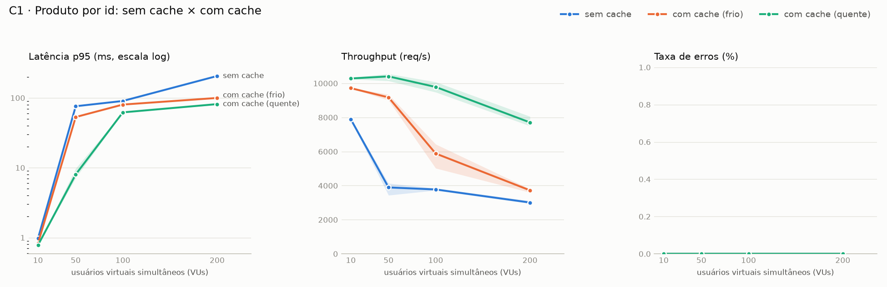
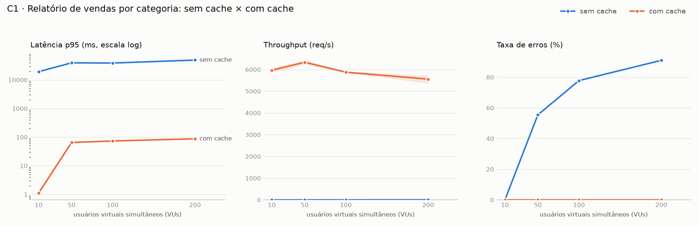
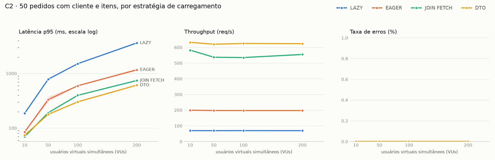
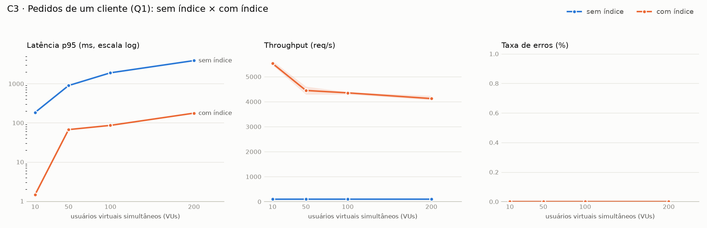

# Testes de carga: rodada `completa`

```
rodada=completa
inicio=2026-11-21T22:43:39-03:00
variantes=produto-sem produto-com-frio produto-com-quente relatorio-sem relatorio-com pedidos-lazy pedidos-eager pedidos-join-fetch pedidos-dto cliente-pedidos-sem-indice cliente-pedidos-com-indice
cargas=10 50 100 200 repeticoes=3 aquecimento=30s coleta=60s n_pedidos=50
db_pool_size=10
host=12 CPUs, 15 GiB RAM, 7.0.0-43-generic
linhas: pedido=200000 item_pedido=1099698 produto=20000 cliente=10000
fim=2026-11-22T02:24:59-03:00
```

Média entre repetições; entre parênteses, mín–máx das repetições. Latências em ms (medidas pelo k6, no cliente). CPU = média do `docker stats` na fase de coleta (100% = 1 núcleo).


## C1 · Produto por id: sem cache × com cache



| Variante | VUs | Req/s | Média | p95 | p99 | Erros (%) | HIT (%) | SQL/req | CPU app (%) | CPU Postgres (%) |
|---|---:|---:|---:|---:|---:|---:|---:|---:|---:|---:|
| sem cache | 10 | 7.890,2 (7.834–7.954) | 1,2 | 1,0 (1,0–1,0) | 40,9 | 0,00 | – | 1,00 | 204 | 106 |
| sem cache | 50 | 3.895,3 (3.436–4.133) | 12,8 | 75,9 (74,9–77,6) | 82,1 | 0,00 | – | 1,00 | 195 | 54 |
| sem cache | 100 | 3.775,9 (3.725–3.847) | 26,4 | 90,3 (90,2–90,5) | 102,5 | 0,00 | – | 1,00 | 195 | 53 |
| sem cache | 200 | 3.009,4 (2.945–3.107) | 66,4 | 205,7 (203,2–207,1) | 311,4 | 0,00 | – | 1,00 | 198 | 43 |
| com cache (frio) | 10 | 9.718,0 (9.706–9.737) | 0,9 | 0,8 (0,8–0,8) | 34,5 | 0,00 | 99,9 | 0,00 | 207 | 1 |
| com cache (frio) | 50 | 9.176,7 (9.004–9.350) | 5,3 | 53,2 (52,4–53,6) | 67,8 | 0,00 | 99,8 | 0,00 | 199 | 1 |
| com cache (frio) | 100 | 5.883,9 (5.019–6.429) | 17,1 | 80,2 (79,2–82,2) | 86,8 | 0,00 | 99,6 | 0,00 | 197 | 2 |
| com cache (frio) | 200 | 3.724,6 (3.601–3.802) | 53,6 | 99,8 (98,8–100,8) | 162,1 | 0,00 | 99,2 | 0,01 | 196 | 2 |
| com cache (quente) | 10 | 10.284,4 (10.249–10.346) | 0,9 | 0,8 (0,8–0,8) | 2,9 | 0,00 | 100,0 | 0,00 | 208 | 1 |
| com cache (quente) | 50 | 10.407,7 (10.144–10.559) | 4,7 | 8,0 (7,1–9,8) | 60,2 | 0,00 | 100,0 | 0,00 | 199 | 1 |
| com cache (quente) | 100 | 9.787,9 (9.481–10.081) | 10,1 | 62,0 (61,3–62,5) | 71,2 | 0,00 | 100,0 | 0,00 | 198 | 1 |
| com cache (quente) | 200 | 7.707,4 (7.500–8.058) | 25,8 | 81,5 (79,7–83,4) | 90,7 | 0,00 | 100,0 | 0,00 | 198 | 1 |

## C1 · Relatório de vendas por categoria: sem cache × com cache



| Variante | VUs | Req/s | Média | p95 | p99 | Erros (%) | HIT (%) | SQL/req | CPU app (%) | CPU Postgres (%) |
|---|---:|---:|---:|---:|---:|---:|---:|---:|---:|---:|
| sem cache | 10 | 0,8 (1–1) | 13.596,0 | 19.362,9 (18.481,2–20.159,6) | 21.285,8 | 0,00 | – | 1,00 | 1 | 200 |
| sem cache | 50 | 1,9 (2–2) | 30.783,0 | 39.397,7 (38.644,2–40.065,4) | 43.154,4 | 55,43 | – | 0,45 | 3 | 200 |
| sem cache | 100 | 3,5 (3–4) | 30.626,2 | 38.782,0 (38.176,3–39.942,8) | 42.177,2 | 77,77 | – | 0,22 | 5 | 200 |
| sem cache | 200 | 6,4 (6–6) | 32.572,5 | 49.222,7 (48.857,0–49.419,5) | 60.000,2 | 90,96 | – | 0,09 | 4 | 199 |
| com cache | 10 | 5.969,6 (5.862–6.052) | 1,6 | 1,1 (1,1–1,1) | 45,0 | 0,00 | 100,0 | 0,00 | 168 | 46 |
| com cache | 50 | 6.334,1 (6.230–6.422) | 7,8 | 65,1 (64,3–65,6) | 71,0 | 0,00 | 100,0 | 0,00 | 198 | 14 |
| com cache | 100 | 5.878,1 (5.849–5.909) | 16,9 | 73,5 (73,1–73,9) | 80,7 | 0,00 | 100,0 | 0,00 | 198 | 10 |
| com cache | 200 | 5.557,5 (5.358–5.715) | 35,9 | 87,6 (85,8–89,8) | 100,4 | 0,00 | 100,0 | 0,00 | 198 | 16 |

## C2 · 50 pedidos com cliente e itens, por estratégia de carregamento



| Variante | VUs | Req/s | Média | p95 | p99 | Erros (%) | HIT (%) | SQL/req | CPU app (%) | CPU Postgres (%) |
|---|---:|---:|---:|---:|---:|---:|---:|---:|---:|---:|
| LAZY | 10 | 69,5 (69–70) | 144,0 | 186,1 (185,6–186,5) | 193,9 | 0,00 | – | 387,00 | 165 | 201 |
| LAZY | 50 | 69,2 (69–69) | 726,6 | 787,6 (786,9–788,7) | 1.296,2 | 0,00 | – | 387,00 | 175 | 204 |
| LAZY | 100 | 69,4 (69–70) | 1.456,8 | 1.512,1 (1.502,3–1.519,5) | 2.706,5 | 0,00 | – | 387,00 | 175 | 205 |
| LAZY | 200 | 69,2 (69–69) | 2.957,8 | 3.627,6 (3.537,6–3.693,8) | 5.609,9 | 0,00 | – | 387,00 | 173 | 204 |
| EAGER | 10 | 199,7 (199–200) | 50,0 | 84,6 (84,4–84,7) | 87,4 | 0,00 | – | 101,00 | 167 | 201 |
| EAGER | 50 | 197,7 (196–199) | 253,3 | 333,1 (303,4–381,1) | 482,6 | 0,00 | – | 101,00 | 180 | 202 |
| EAGER | 100 | 197,6 (197–198) | 508,2 | 596,3 (593,0–601,5) | 984,3 | 0,00 | – | 101,00 | 181 | 203 |
| EAGER | 200 | 197,5 (198–198) | 1.020,9 | 1.166,5 (1.125,4–1.236,7) | 1.995,9 | 0,00 | – | 101,00 | 176 | 204 |
| JOIN FETCH | 10 | 582,4 (582–584) | 17,1 | 69,4 (69,2–69,5) | 74,4 | 0,00 | – | 1,00 | 143 | 199 |
| JOIN FETCH | 50 | 537,4 (536–539) | 93,0 | 191,6 (190,8–192,1) | 266,4 | 0,00 | – | 1,00 | 180 | 188 |
| JOIN FETCH | 100 | 535,4 (534–536) | 186,8 | 398,3 (396,5–399,8) | 551,4 | 0,00 | – | 1,00 | 188 | 187 |
| JOIN FETCH | 200 | 555,1 (551–558) | 361,1 | 743,6 (727,9–773,7) | 1.090,6 | 0,00 | – | 1,00 | 176 | 193 |
| DTO | 10 | 632,5 (632–633) | 15,7 | 74,0 (73,9–74,2) | 77,6 | 0,00 | – | 1,00 | 86 | 199 |
| DTO | 50 | 620,3 (619–621) | 80,5 | 178,9 (178,6–179,2) | 198,0 | 0,00 | – | 1,00 | 107 | 198 |
| DTO | 100 | 625,1 (624–627) | 160,0 | 302,3 (301,9–302,6) | 416,8 | 0,00 | – | 1,00 | 112 | 199 |
| DTO | 200 | 623,8 (623–625) | 321,3 | 611,7 (611,6–611,9) | 907,9 | 0,00 | – | 1,00 | 103 | 200 |

## C3 · Pedidos de um cliente (Q1): sem índice × com índice



| Variante | VUs | Req/s | Média | p95 | p99 | Erros (%) | HIT (%) | SQL/req | CPU app (%) | CPU Postgres (%) |
|---|---:|---:|---:|---:|---:|---:|---:|---:|---:|---:|
| sem índice | 10 | 98,0 (98–98) | 101,9 | 184,6 (184,1–185,1) | 189,4 | 0,00 | – | 1,00 | 21 | 198 |
| sem índice | 50 | 99,1 (99–99) | 506,8 | 897,2 (896,1–898,5) | 989,2 | 0,00 | – | 1,00 | 21 | 200 |
| sem índice | 100 | 99,3 (99–99) | 1.015,5 | 1.898,8 (1.897,8–1.899,9) | 1.991,9 | 0,00 | – | 1,00 | 22 | 200 |
| sem índice | 200 | 99,3 (99–99) | 2.048,2 | 3.905,3 (3.904,8–3.906,1) | 5.018,8 | 0,00 | – | 1,00 | 20 | 200 |
| com índice | 10 | 5.530,3 (5.465–5.638) | 1,7 | 1,5 (1,4–1,5) | 48,4 | 0,00 | – | 1,00 | 201 | 119 |
| com índice | 50 | 4.449,0 (4.288–4.609) | 11,1 | 67,2 (66,2–68,8) | 77,8 | 0,00 | – | 1,00 | 194 | 97 |
| com índice | 100 | 4.354,3 (4.293–4.386) | 22,9 | 86,1 (85,6–86,9) | 99,8 | 0,00 | – | 1,00 | 194 | 95 |
| com índice | 200 | 4.124,5 (4.064–4.239) | 48,4 | 177,2 (172,1–180,0) | 220,9 | 0,00 | – | 1,00 | 196 | 91 |
