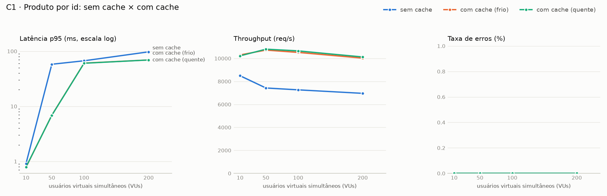
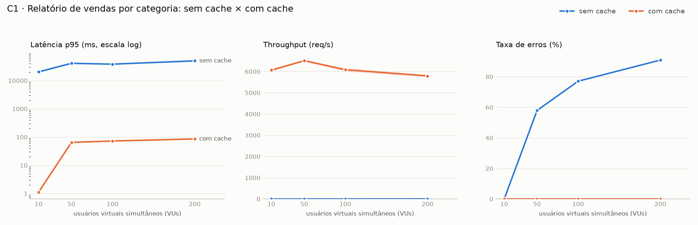
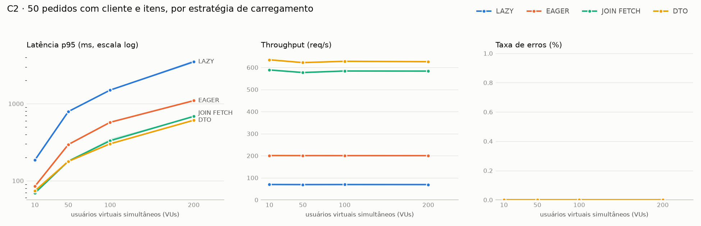
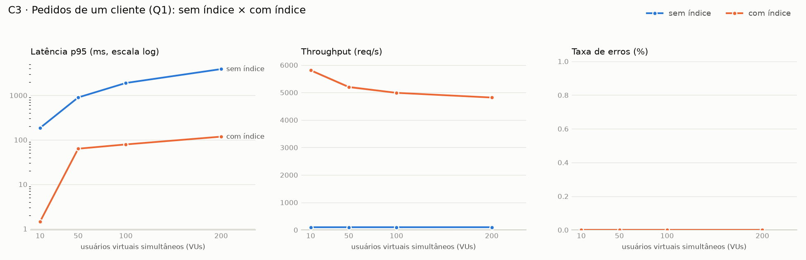

# Testes de carga: rodada `completa2`

```
rodada=completa2
inicio=2026-11-22T02:42:19-03:00
variantes=produto-sem produto-com-frio produto-com-quente relatorio-sem relatorio-com pedidos-lazy pedidos-eager pedidos-join-fetch pedidos-dto cliente-pedidos-sem-indice cliente-pedidos-com-indice
cargas=10 50 100 200 repeticoes=3 preaquecimento=30s@10vus aquecimento=30s coleta=60s n_pedidos=50
db_pool_size=10
host=12 CPUs, 15 GiB RAM, 7.0.0-43-generic
linhas: pedido=200000 item_pedido=1099698 produto=20000 cliente=10000
fim=2026-11-22T07:35:30-03:00
```

Média entre repetições; entre parênteses, mín–máx das repetições. Latências em ms (medidas pelo k6, no cliente). CPU = média do `docker stats` na fase de coleta (100% = 1 núcleo).


## C1 · Produto por id: sem cache × com cache



| Variante | VUs | Req/s | Média | p95 | p99 | Erros (%) | HIT (%) | SQL/req | CPU app (%) | CPU Postgres (%) |
|---|---:|---:|---:|---:|---:|---:|---:|---:|---:|---:|
| sem cache | 10 | 8.492,6 (8.414–8.537) | 1,1 | 0,9 (0,9–0,9) | 39,8 | 0,00 | – | 1,00 | 205 | 112 |
| sem cache | 50 | 7.428,3 (7.362–7.473) | 6,6 | 58,0 (57,7–58,3) | 63,1 | 0,00 | – | 1,00 | 198 | 97 |
| sem cache | 100 | 7.265,2 (7.222–7.296) | 13,7 | 67,1 (66,9–67,4) | 77,5 | 0,00 | – | 1,00 | 198 | 95 |
| sem cache | 200 | 6.960,4 (6.922–6.982) | 28,6 | 97,5 (97,3–97,8) | 161,1 | 0,00 | – | 1,00 | 198 | 91 |
| com cache (frio) | 10 | 10.303,1 (10.295–10.315) | 0,9 | 0,8 (0,8–0,8) | 3,1 | 0,00 | 100,0 | 0,00 | 208 | 1 |
| com cache (frio) | 50 | 10.725,6 (10.658–10.773) | 4,6 | 6,9 (6,8–7,0) | 59,4 | 0,00 | 100,0 | 0,00 | 198 | 1 |
| com cache (frio) | 100 | 10.524,3 (10.456–10.586) | 9,4 | 60,9 (60,6–61,3) | 65,5 | 0,00 | 100,0 | 0,00 | 198 | 1 |
| com cache (frio) | 200 | 10.029,3 (9.948–10.104) | 19,8 | 69,5 (69,3–69,7) | 76,5 | 0,00 | 100,0 | 0,00 | 198 | 1 |
| com cache (quente) | 10 | 10.221,8 (10.186–10.244) | 0,9 | 0,8 (0,8–0,8) | 3,1 | 0,00 | 100,0 | 0,00 | 208 | 1 |
| com cache (quente) | 50 | 10.801,8 (10.742–10.884) | 4,5 | 6,9 (6,7–7,0) | 59,4 | 0,00 | 100,0 | 0,00 | 199 | 1 |
| com cache (quente) | 100 | 10.652,0 (10.566–10.749) | 9,3 | 60,5 (60,1–61,0) | 65,1 | 0,00 | 100,0 | 0,00 | 198 | 1 |
| com cache (quente) | 200 | 10.125,8 (10.106–10.140) | 19,6 | 69,4 (69,3–69,5) | 76,4 | 0,00 | 100,0 | 0,00 | 198 | 1 |

## C1 · Relatório de vendas por categoria: sem cache × com cache



| Variante | VUs | Req/s | Média | p95 | p99 | Erros (%) | HIT (%) | SQL/req | CPU app (%) | CPU Postgres (%) |
|---|---:|---:|---:|---:|---:|---:|---:|---:|---:|---:|
| sem cache | 10 | 0,8 (1–1) | 13.807,2 | 20.333,4 (18.832,7–22.417,5) | 21.968,8 | 0,00 | – | 1,00 | 1 | 200 |
| sem cache | 50 | 1,8 (2–2) | 30.890,8 | 41.070,0 (38.200,5–43.177,9) | 43.657,2 | 57,94 | – | 0,42 | 3 | 200 |
| sem cache | 100 | 3,5 (4–4) | 30.555,6 | 38.181,4 (37.695,1–38.783,9) | 42.935,3 | 77,08 | – | 0,23 | 4 | 200 |
| sem cache | 200 | 6,4 (6–6) | 32.454,8 | 50.139,8 (45.936,3–54.673,6) | 60.000,6 | 90,90 | – | 0,09 | 3 | 199 |
| com cache | 10 | 6.068,2 (5.992–6.119) | 1,6 | 1,1 (1,1–1,1) | 45,4 | 0,00 | 100,0 | 0,00 | 174 | 41 |
| com cache | 50 | 6.512,4 (6.478–6.540) | 7,6 | 64,8 (64,5–65,1) | 70,8 | 0,00 | 100,0 | 0,00 | 198 | 11 |
| com cache | 100 | 6.087,0 (5.996–6.158) | 16,3 | 72,6 (72,3–72,8) | 79,0 | 0,00 | 100,0 | 0,00 | 198 | 9 |
| com cache | 200 | 5.795,4 (5.735–5.849) | 34,4 | 85,8 (85,7–86,2) | 97,6 | 0,00 | 100,0 | 0,00 | 198 | 9 |

## C2 · 50 pedidos com cliente e itens, por estratégia de carregamento



| Variante | VUs | Req/s | Média | p95 | p99 | Erros (%) | HIT (%) | SQL/req | CPU app (%) | CPU Postgres (%) |
|---|---:|---:|---:|---:|---:|---:|---:|---:|---:|---:|
| LAZY | 10 | 69,7 (70–70) | 143,5 | 185,5 (185,4–185,7) | 193,1 | 0,00 | – | 387,00 | 169 | 201 |
| LAZY | 50 | 69,3 (69–69) | 724,9 | 790,8 (786,3–794,1) | 1.291,7 | 0,00 | – | 387,00 | 174 | 204 |
| LAZY | 100 | 69,5 (69–70) | 1.455,3 | 1.502,8 (1.499,7–1.506,9) | 2.705,3 | 0,00 | – | 387,00 | 175 | 205 |
| LAZY | 200 | 69,4 (69–69) | 2.950,5 | 3.507,1 (3.389,0–3.691,5) | 5.601,2 | 0,00 | – | 387,00 | 175 | 205 |
| EAGER | 10 | 200,9 (201–201) | 49,7 | 84,6 (84,5–84,7) | 87,3 | 0,00 | – | 101,00 | 155 | 201 |
| EAGER | 50 | 200,6 (200–201) | 249,6 | 295,4 (294,9–296,1) | 475,9 | 0,00 | – | 101,00 | 168 | 203 |
| EAGER | 100 | 200,5 (200–201) | 500,7 | 573,8 (567,9–577,0) | 971,9 | 0,00 | – | 101,00 | 170 | 205 |
| EAGER | 200 | 200,4 (200–200) | 1.006,0 | 1.096,9 (1.092,7–1.102,6) | 1.972,9 | 0,00 | – | 101,00 | 164 | 205 |
| JOIN FETCH | 10 | 588,8 (588–589) | 16,9 | 69,3 (68,9–69,6) | 74,3 | 0,00 | – | 1,00 | 136 | 198 |
| JOIN FETCH | 50 | 577,1 (574–581) | 86,5 | 179,6 (179,1–180,0) | 207,2 | 0,00 | – | 1,00 | 174 | 198 |
| JOIN FETCH | 100 | 584,0 (582–585) | 171,3 | 331,6 (318,4–355,5) | 478,7 | 0,00 | – | 1,00 | 178 | 198 |
| JOIN FETCH | 200 | 583,5 (583–584) | 343,7 | 685,4 (685,1–685,8) | 988,2 | 0,00 | – | 1,00 | 164 | 201 |
| DTO | 10 | 634,8 (634–636) | 15,7 | 73,9 (73,7–74,2) | 77,5 | 0,00 | – | 1,00 | 85 | 198 |
| DTO | 50 | 622,1 (622–623) | 80,3 | 178,5 (178,4–178,5) | 197,5 | 0,00 | – | 1,00 | 108 | 199 |
| DTO | 100 | 628,0 (628–629) | 159,3 | 301,8 (301,6–301,9) | 415,1 | 0,00 | – | 1,00 | 114 | 199 |
| DTO | 200 | 626,1 (626–627) | 320,1 | 610,5 (610,3–610,7) | 905,8 | 0,00 | – | 1,00 | 103 | 201 |

## C3 · Pedidos de um cliente (Q1): sem índice × com índice



| Variante | VUs | Req/s | Média | p95 | p99 | Erros (%) | HIT (%) | SQL/req | CPU app (%) | CPU Postgres (%) |
|---|---:|---:|---:|---:|---:|---:|---:|---:|---:|---:|
| sem índice | 10 | 98,8 (99–99) | 101,1 | 184,9 (184,8–185,1) | 189,2 | 0,00 | – | 1,00 | 11 | 198 |
| sem índice | 50 | 99,7 (100–100) | 503,6 | 896,8 (896,3–897,5) | 986,9 | 0,00 | – | 1,00 | 13 | 200 |
| sem índice | 100 | 99,8 (100–100) | 1.009,4 | 1.896,1 (1.894,8–1.897,0) | 1.988,4 | 0,00 | – | 1,00 | 12 | 200 |
| sem índice | 200 | 100,1 (100–100) | 2.030,4 | 3.899,4 (3.898,9–3.900,0) | 5.718,3 | 0,00 | – | 1,00 | 12 | 200 |
| com índice | 10 | 5.810,0 (5.767–5.846) | 1,6 | 1,4 (1,4–1,5) | 48,3 | 0,00 | – | 1,00 | 204 | 127 |
| com índice | 50 | 5.200,5 (5.163–5.258) | 9,5 | 63,2 (63,0–63,4) | 68,7 | 0,00 | – | 1,00 | 199 | 111 |
| com índice | 100 | 4.989,2 (4.974–5.015) | 19,9 | 78,9 (78,6–79,1) | 91,2 | 0,00 | – | 1,00 | 199 | 107 |
| com índice | 200 | 4.818,4 (4.802–4.829) | 41,4 | 118,0 (117,6–118,5) | 193,6 | 0,00 | – | 1,00 | 199 | 104 |
